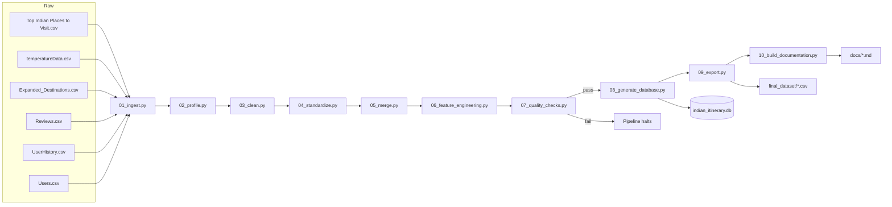
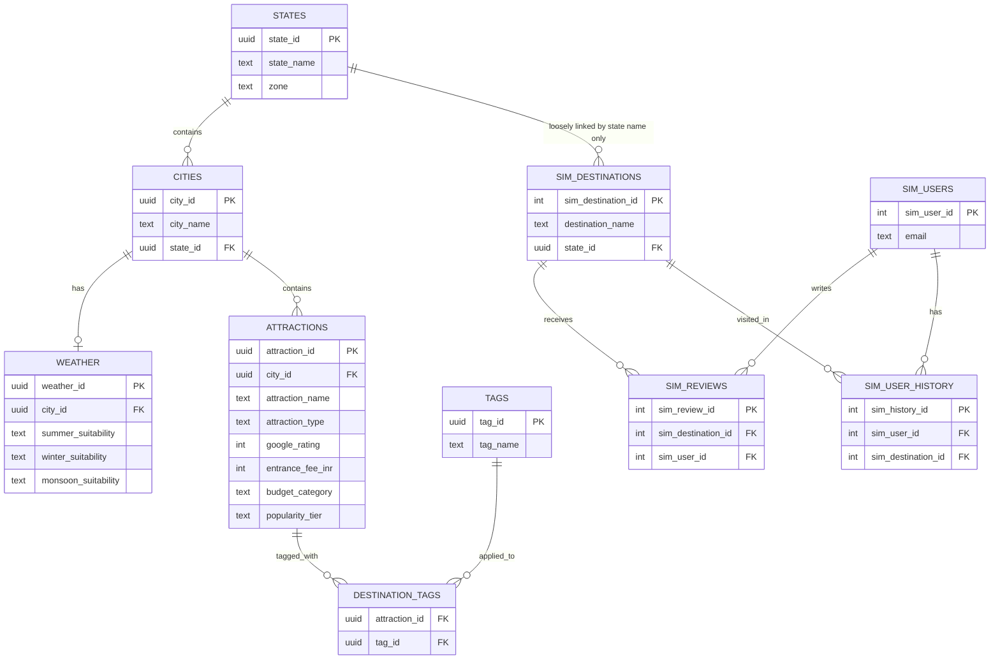
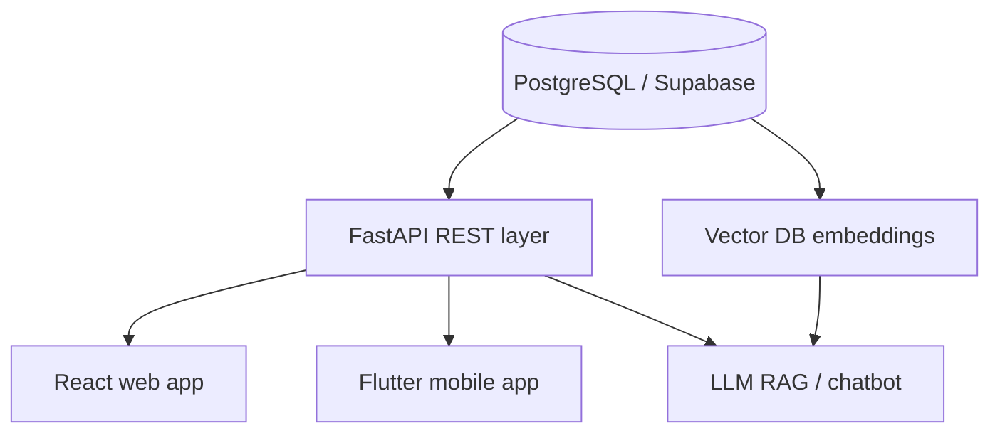

# Architecture

## Pipeline (data flow)

## Entity-relationship model

## Why two domains instead of one merged dataset

`attractions` (real, 323 rows after cleaning) and `sim_destinations` (synthetic,
1,000 rows) describe different things at different granularities and cannot be
honestly joined 1:1 — see `docs/DATASET_UNDERSTANDING.md` for the evidence.
Faking that join would look impressive for about five minutes until someone
queried it. Keeping them separate, with the *only* real link being `state_id`,
is the correct data-modeling call and is the kind of judgment call a senior
analytics engineer is expected to make and document.

## Future scalability (not built now, architected for)

The schema already uses UUID primary keys and a normalized structure so it
can be loaded into PostgreSQL/Supabase unchanged, fronted by a FastAPI
service, and used as the retrieval layer for a travel-recommendation RAG
system without a redesign.
