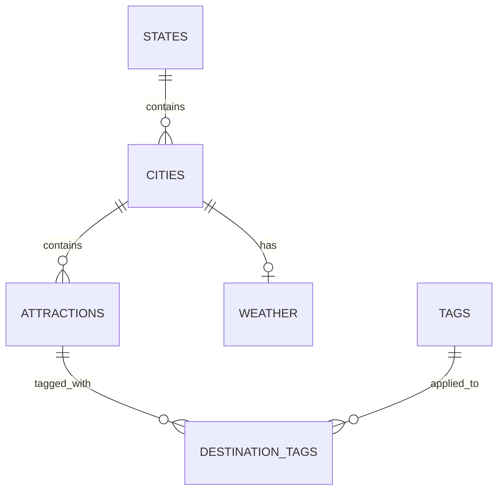

# Semantic model blueprint

## Core tables

- Attractions
  - Fact table for destination-level business analysis.
  - Key fields: attraction_id, attraction_name, city_id, attraction_type, significance, google_rating, entrance_fee_inr, visit_duration_hrs, estimated_daily_cost_inr, popularity_tier, travel_complexity, budget_category, family_score, solo_score, couple_score, adventure_indicator, nature_indicator, heritage_indicator, religious_indicator, digital_nomad_friendly, backpacker_friendly, senior_friendly.
- Cities
  - Dimension table for city-level slicing.
  - Key fields: city_id, city_name, state_id.
- States
  - Dimension table for executive geography analysis.
  - Key fields: state_id, state_name, zone.
- Weather
  - Dimension-like supporting table for seasonal analysis.
  - Key fields: city_id, avg_max_temp_c, avg_min_temp_c, summer_suitability, winter_suitability, monsoon_suitability.
- Tags
  - Dimension table for categorical analysis.
  - Key fields: tag_id, tag_name.
- Destination_Tags
  - Bridge table connecting attractions to tag categories.

## Recommended relationships

## Power BI calculated columns to create

- Budget Band
  - `Free`, `Low`, `Medium`, `High`, `Premium` based on `entrance_fee_inr` and `estimated_daily_cost_inr`.
- Rating Band
  - `Below 4.0`, `4.0–4.4`, `4.5+` based on `google_rating`.
- Visit Duration Band
  - `Short`, `Medium`, `Long` based on `visit_duration_hrs`.
- Popularity Band
  - `Emerging`, `Popular`, `Iconic` based on `popularity_tier` or review volume.
- Travel Profile
  - `Family`, `Solo`, `Couple`, `Adventure`, `Backpacker`, `Digital Nomad` based on the engineered score flags.
- Season Recommendation
  - Derived from `suggested_season_note`, `summer_suitability`, `winter_suitability`, and `monsoon_suitability`.

## Modeling notes

- Use the flattened CSV export as the primary ingestion source for the report to preserve compatibility with the existing repository.
- Use the normalized SQLite database as the source of truth for validation and future backend integration.
- Keep the synthetic engagement tables separate from the real attraction model unless a future version explicitly requires a merged recommendation model.
